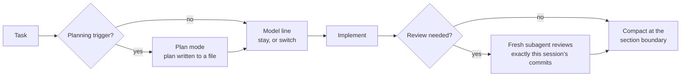

# may-kit

**An opinionated Claude Code setup that decides _when_ to plan, _which_ model does the work, _when_ to review and _when_ to compact — and turns Claude's own hints into one-click buttons.**


```
 [→ Sonnet high]  [↺ Opus xhigh]  [Review]  [Komprimieren]  [Live]  [⚡]  [?]
 ❯ _
```

Out of the box, Claude Code leaves the process up to the model: it may plan a one-line fix and dive straight into a migration, run everything on the most expensive model, review its own work by agreeing with itself, and keep dragging a bloated context from one task into the next. may-kit puts that process into three pieces that work together and lives in `~/.claude/`, so it applies in **every** repository on **every** machine.

| Piece | What it does |
|---|---|
| [`CLAUDE.md`](CLAUDE.md) | Global working rules: planning triggers, model choice, compaction, review |
| [`output-styles/marius.md`](output-styles/marius.md) | How Claude answers: result first, short, every hint in a fixed shape |
| [`mods/may-kit-panel`](mods/may-kit-panel) | A row of buttons above the prompt that reads those hints and runs them |

## How it works



### 1. Rules — `CLAUDE.md`

- **Planning by checklist, not by gut feeling.** Plan mode is mandatory as soon as one trigger applies: three or more files, a database migration, auth or security, shared foundation code, concurrency, money logic, a new pattern — or a bug whose cause isn't understood yet. The list beats the model's self-assessment, because a model that hasn't understood a bug usually thinks it's simple.
- **A model line before every change.** Either *"Opus xhigh fits, because …"* with a named reason, or a ready-to-run switch: `/model` → Sonnet, Effort high. Opus makes the decisions; Sonnet high carries out a finished plan.
- **Plans live in files** (`docs/plans/<date>-<slug>.md`), so they survive compaction and the end of the session — and another model can carry them out without redesigning the architecture.
- **An escalation protocol** for when the executing model finds out the plan is wrong: stop, leave the work in a named state, hand back to the stronger model.
- **Compact at section boundaries, not at a token count.** Plan approved, stage committed, bug found: that's when Claude offers a `/compact` with exactly the instructions the next section needs.
- **Reviews that look for bugs instead of confirming them.** A fresh subagent checks exactly the session's own commits (`git show <sha>`), so parallel sessions in the same working tree never end up in each other's review. Findings come graded *Critical / High / Medium / Low*.
- **Evidence before claims.** Nothing is called "fixed" or "green" before the check has run and its output has been read.

Project rules always win: a repository's own `CLAUDE.md` overrides this one, and may-kit fills the gaps.

### 2. Output style — `Marius`

Result first, short whole sentences, no narration of which file gets read next, no closing summary. What is never cut: `file:line`, error messages, numbers and warnings. Hints about the model, compacting and review always appear in the same fixed shape — that's what makes the panel possible:

````
**Weiter:** erst `/compact`, dann `/model` → Sonnet, Effort high. Plan ist bindend.
Plan: `docs/plans/2026-11-03-checkout.md` · danach Opus-Review
```
/compact Etappe 4 umsetzen; Grundlage docs/plans/…-checkout.md §3
```
````

### 3. Panel — `may-kit-panel`

A Claude Code mod that reads the last answer after every turn and highlights the step that is due. One click runs it.

| Button | Shows | On click |
|---|---|---|
| **Modell + Effort** | always; highlighted after a `**Weiter:**` hint | runs the hint's `/compact` (if any), `/model`, `/effort`, then sends the order to carry out the plan |
| **↺** | after a switch | restores the model and effort from before the first switch |
| **Review** | always; highlighted after a `REVIEW-EMPFEHLUNG` | sends *"Review starten"* with the recommended commits; a subagent reviews, the session fixes |
| **Komprimieren** | always; highlighted after a compact hint | compacts with the instructions from the last `/compact` line |
| **Live** | if the repo has `scripts/merge.ps1` | sends *"Release nach production"*; the project's `CLAUDE.md` defines what that means |
| **⚡** | if the repo has `.claude/arbeitsmodus` | toggles careful mode and fast mode for all sessions |
| **?** | always | explains every visible button below the row |

While a review, compaction or release runs, a spinner stands in for the button; clicking it clears the indicator by hand.

## Quick start

**Let Claude do it.** In any Claude Code session:

> Richte may-kit ein, nach https://github.com/mariusmaydev/may-kit/blob/main/INSTALL.md

Claude installs everything, checks it, and offers to set up the optional project parts (working mode, release button).

**Windows, by hand** (needs Node and `gh`, symlinks work with Developer Mode):

```powershell
cd $env:USERPROFILE\Documents\GitHub
gh repo clone mariusmaydev/may-kit
cd may-kit
powershell -ExecutionPolicy Bypass -File .\install.ps1
```

**macOS / Linux, by hand** (move an existing `~/.claude/CLAUDE.md` or `~/.claude/output-styles` out of the way first):

```sh
git clone https://github.com/mariusmaydev/may-kit.git ~/may-kit
ln -s ~/may-kit/CLAUDE.md ~/.claude/CLAUDE.md
ln -s ~/may-kit/output-styles ~/.claude/output-styles
node ~/may-kit/set-user-settings.cjs ~/.claude/settings.json "$(date +%Y%m%d%H%M%S)" Marius ~/may-kit/mods/may-kit-panel
```

The installer links `CLAUDE.md` and `output-styles/` into `~/.claude/`, backs up whatever was there as `*.bak-<timestamp>`, and changes exactly two keys in `~/.claude/settings.json`: `outputStyle` and `env.CLAUDE_CODE_PLUGIN_DIRS`. Open a **new** chat afterwards — style and mod load at session start.

## Make it yours

- **Fork it.** The files are linked, not copied: edit them in your clone, commit, and `git pull` on your other machines.
- **Language.** Rules and style are written in German, and Claude answers in German. Claude follows the rules just as well in any language; to get English answers, change the *Sprache* section of the style. If you translate the hints, keep the markers the panel looks for (`**Weiter:**`, `Jetzt komprimieren`, `REVIEW-EMPFEHLUNG`, `Commits:`) or adjust the patterns in [`register.tsx`](mods/may-kit-panel/hooks/register.tsx).
- **Machine-specific parts.** §7 of `CLAUDE.md` describes a shared Chrome setup on my own machine; drop it or replace it with yours.
- **Model names.** The rules speak of Opus and Sonnet with effort levels `medium | high | xhigh`; rename them if your lineup differs.

## Repository layout

```
CLAUDE.md                 global rules, linked to ~/.claude/CLAUDE.md
INSTALL.md                setup prompt for Claude (machine + project)
install.ps1               Windows installer
set-user-settings.cjs     sets the two settings keys, touches nothing else
output-styles/marius.md   the output style
mods/may-kit-panel/       the button panel (hooks/register.tsx, tests/)
```

## Development

```sh
claude plugin validate mods/may-kit-panel
claude plugin test mods/may-kit-panel
```

Never commit credentials, tokens or token prefixes. Machine-specific things (paths, SSH hosts, logins) stay out of this repo; project rules belong in the project's own `CLAUDE.md`.

## License

[MIT](LICENSE)
